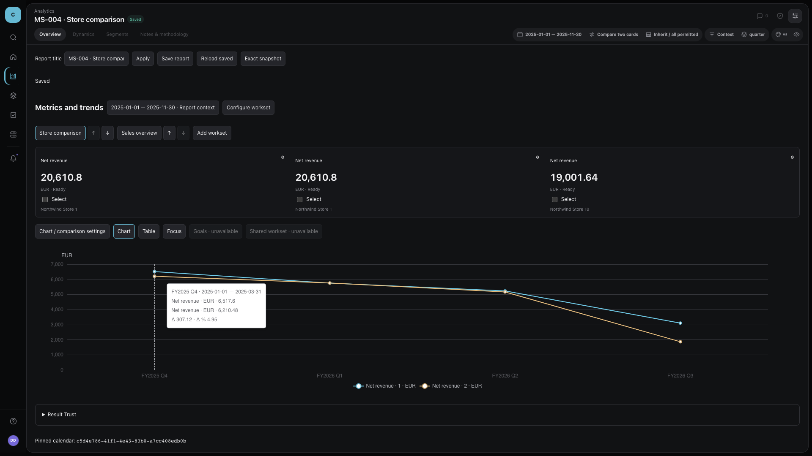
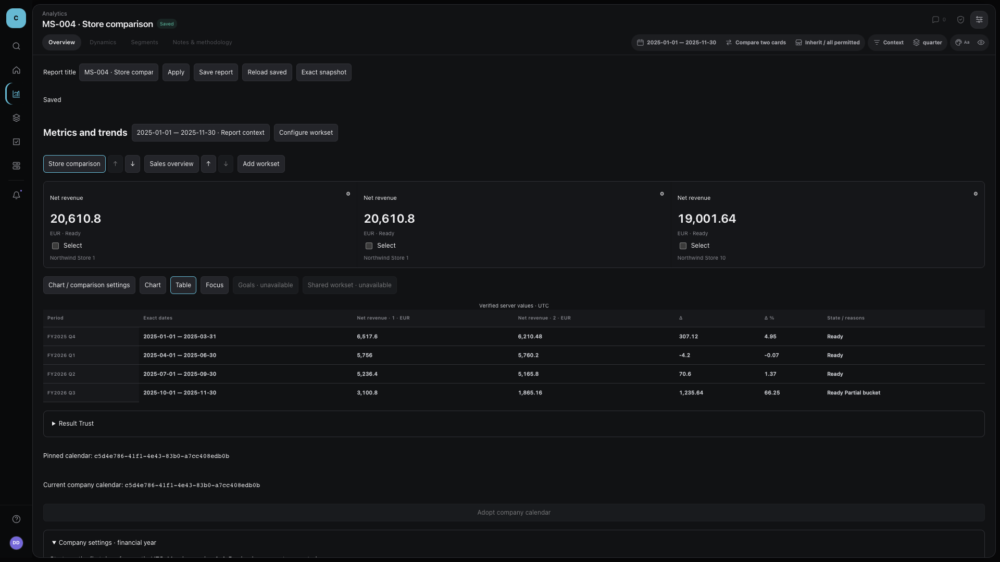
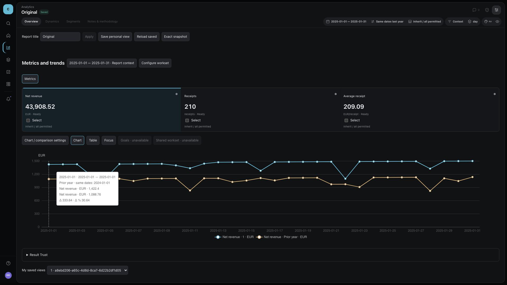
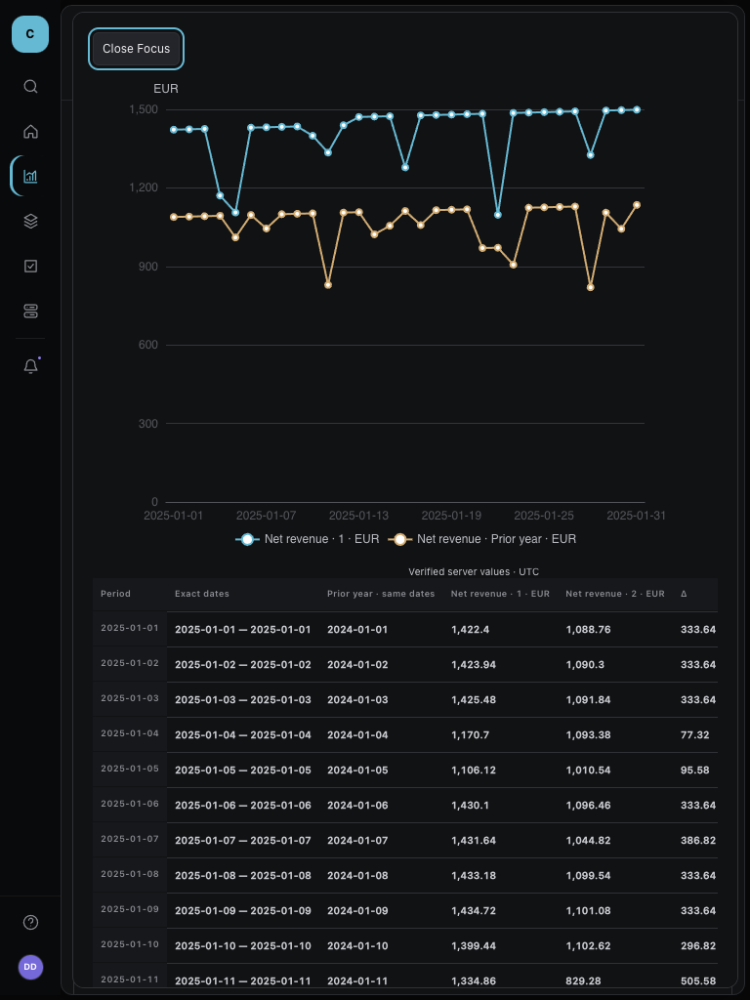

# MS-004 S05 owner demonstration

Review the actual local native-pilot result and decide whether the accepted C01
behavior meets expectations. Technical pass and initial plan approval do not count
as this finished-result decision. The original S05 executor retains the claim.
Final-state logout and reload transport proofs are also available in the browser
manifest; screenshots alone are not claimed to establish those temporal assertions.

## What to inspect

1. Independent worksets/cards and store scope: two worksets and six cards; repeated
   revenue for the same store shares an admitted result but retains separate card
   IDs; a different store has a different result. The inactive workset is preserved.
2. Financial calendar: company default is a base setting. A changed default leaves
   the report's old pin/snapshot unchanged; explicit creator adoption followed by
   Apply/Save creates the new result. Actual quarter dates and FY labels match.
3. Comparisons: exact server values, dates, baseline dates, deltas and unavailable
   reasons agree between chart, accessible table, tooltip and Focus. The receipt
   count/revenue pair explains incompatible units instead of inventing a delta.
4. Reader view: the reader cannot edit the report or company calendar, but can save
   its own view and reopen it after run authorization is withdrawn, without source
   computation. The saved comparison and its reasons remain present.
5. Interaction: RU/EN, keyboard inspector/Focus traversal and Escape return, narrow
   layouts, explicit Apply/Save, retained losing draft and unavailable empty scope.
   A completed late response cannot restore data after logout or overwrite a saved
   context selected while Apply was in flight.

## Captured local result

These are final-source captures from the focused verification and final fiscal
scenario. The browser manifest binds every capture and final source hash. All
images contain task-owned synthetic data, not customer/provider data.

### Fiscal quarter comparison





### Temporal comparison and keyboard Focus





### Narrow layout

[400px fiscal reflow](browser/layout-final/parity-S05-fiscal-multi-wo-0512d-ots-and-owner-demonstration-1920/fiscal-400.png)

The final focused-run RU catalog and saved-reader-pair captures remain supporting
semantic evidence in the browser manifest. They precede the last CSS-only Focus
inset/table reflow correction; the fiscal and temporal images above use that final
layout. Their values, authorization and localized-unit behavior are unchanged.

## Reproduction and proof boundary

Run the checked-in real fixture via:

```sh
source scripts/activate-toolchain.sh
corepack pnpm --filter @custometry/web exec playwright test --config ../../tests/e2e/ms-004-workspace/playwright.config.ts
```

It provisions task-owned source/control PostgreSQL, performs six-entity intake and
admission, starts the production API and maintained native pilot on loopback, then
cleans its runtime. It does not leave a permanent demonstration URL. The accepted
stage deliberately makes no packaged, deployment or release claim.

The [criterion matrix](criterion-matrix.md) and [validation record](validation.md)
provide real API/storage evidence behind screenshots, including failures and
recovery cases that a static image cannot prove. State remains awaiting actual
owner review once technical checks and the review-ready receipt are complete.

## Decision to record

Accept the demonstrated personal-workset and financial-calendar behavior, or name
the concrete discrepancy to correct within C01. There is no required magic phrase.
The coordinator must relay the actual decision to this same executor; it must not
infer acceptance or transition the executor's claim. No owner decision has yet
been recorded in this evidence.
